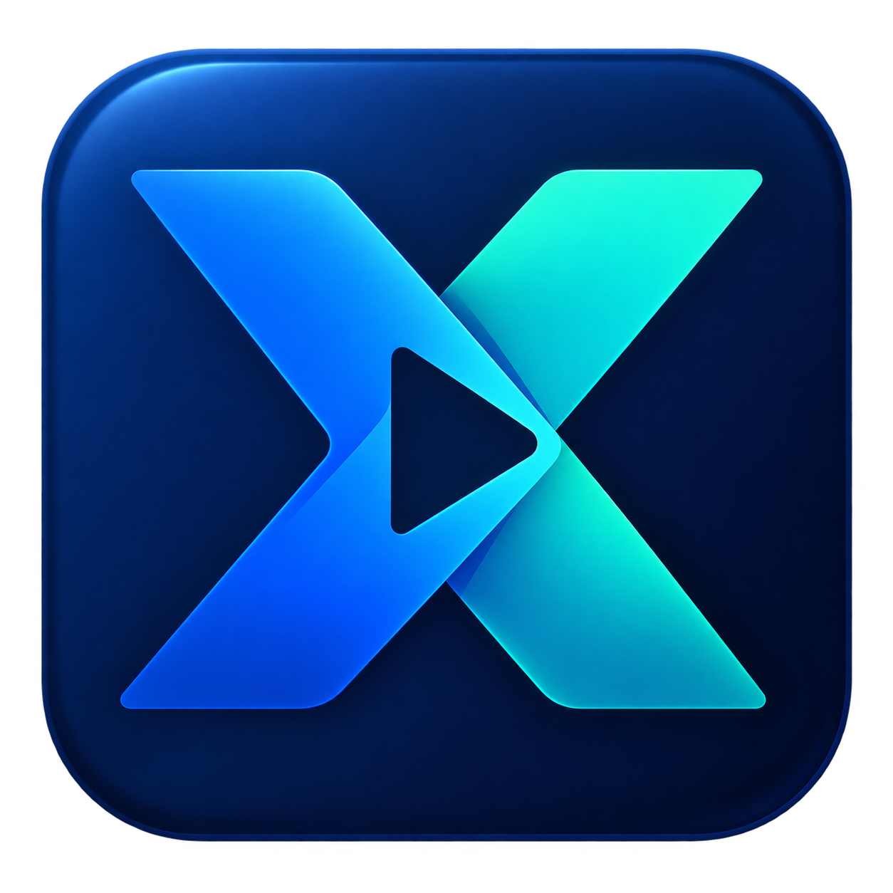

<p align="center"></p>
<h1 align="center">XCL2</h1>
<p align="center"><strong>ゲームの起動、インスタンス管理、AI との作業を、ひとつのデスクトップに。</strong></p>
<p align="center">Windows · .NET 8 · WPF · AGPL-3.0</p>
<p align="center"><a href="../../README.md">简体中文</a> · <a href="README.zh-Hant.md">繁體中文</a> · <a href="README.en.md">English</a> · <a href="README.ru.md">Русский</a> · <strong>日本語</strong></p>

---

XCL2 は、Minecraft のインスタンス管理を中心とした独立系の Windows 用ゲームランチャーです。ダウンロード、アカウント、MOD・MOD パック、マルチプレイ用ツール、パフォーマンス情報、AI アシスタントをまとめています。従来の画面を使うことも、新しい UI のプレビューを有効にして、テーマ、アニメーション、ショートカット、タッチ操作を調整することもできます。

**ここはソースコードのリポジトリです。** GitHub の「Download ZIP」で取得できるのはソースコードであり、インストーラーではありません。実行可能なプログラムは、メンテナーが Releases に実際のビルド成果物を公開した場合にのみ入手できます。未公開のリリースや URL は案内していません。

## 主な機能

| 分野 | 内容 |
| --- | --- |
| インスタンスとアカウント | ゲームのインスタンス、起動引数、Java 環境、アカウントを管理。 |
| コンテンツ | バージョンの取得、MOD、MOD パック、リソースパック、シェーダー、ワールド、ダウンロードタスクの管理。 |
| AI アシスタント | 会話、添付ファイル、履歴、モデル選択。調査・計画・許可された操作を補助し、実行過程を表示。 |
| マルチプレイとサーバー | サーバー管理、接続診断、Terracotta 連携。利用できるサービスと依存コンポーネントが必要。 |
| デスクトップ体験 | ライト／ダークテーマ、多言語、アニメーション設定、タッチキー、ショートカット、パフォーマンス表示、最前面設定。 |
| 実験的な機能 | Mini World 関連の入口と CDK／直接リンクによるダウンロード。説明の確認と、配布元が対応する有効なソースが必要。 |

コピーと再生成のボタンは、透明な背景と枠線で常時表示されます。実行の詳細はアニメーション付きで開閉できます。新 UI プレビューでは既存のナビゲーションとカードの見た目を調整します。文書の言語とアプリの表示言語は別です。一部の実験機能は現在、簡体字中国語の UI にのみ表示されます。

## 使い始める

1. プログラムが公開されている場合は、元のプロジェクトであることを確認した Releases から配布物一式を取得し、配布者、変更内容、公開されたチェックサムを確認します。
2. ディレクトリ全体を展開して `XCL2.exe` を実行します。WebView2 などの依存ファイルも必要なため、EXE だけをコピーしないでください。
3. 必要に応じてアカウント、ゲームの場所、インスタンス、Java を設定し、対象を選んで起動します。
4. AI には対応サービス、モデル、自分の認証情報の設定が必要です。可用性、料金、データの取り扱いは各サービス提供者の条件によります。

このソースにはゲームの利用権、有料素材の権利、汎用 CDK は付属しません。XCL2 は Mojang、Microsoft、その他のゲーム権利者と公式な関係を持たず、それらによる公認も受けていません。オープンソースであることは、第三者の利用条件を置き換えません。

## ソースからビルド

Windows デスクトップと .NET 8 SDK を使用します。主プロジェクトのターゲットは `net8.0-windows10.0.19041.0`、宣言上の最低対応プラットフォームは Windows 10 1809 です。個別モジュールには追加要件があります。x86、x64、ARM64 の構成はありますが、外部コンポーネントすべての対応を保証するものではありません。

既存の Bedrock モジュールには、**それぞれ 96 桁の 16 進数である `XCL2_PRE_KEY` と `XCL2_REL_KEY`** が必要です。値は付属しません。適法に利用できるビルド設定を準備してから、リポジトリのルートで実行します。

```powershell
dotnet restore .\XCL2.App\XCL2.App.csproj
dotnet build .\XCL2.App\XCL2.App.csproj -c Release -p:SkipNativePreview=true
```

独立した WinUI プレビュー実行ファイルのビルドを省略しますが、WPF 内の新 UI プレビューは残ります。詳細は中国語・英語の[ビルドガイド](../BUILDING.md)を参照してください。外部設定が必要なため、追加設定なしの再現可能なビルドが確認済みという意味ではありません。

Windows での回帰チェック：

```powershell
powershell -ExecutionPolicy Bypass -File .\XCL2.App\Tests\Test-AiPresentation.ps1
powershell -ExecutionPolicy Bypass -File .\XCL2.App\Tests\Test-October29Changes.ps1 -IncludeWindowsUi
```

これまでの配布準備では静的チェックを行いましたが、準備環境で Windows のビルドと実機動作確認は行っていません。ビルド成功を示す表示は付けていません。

## ドキュメント

| 文書 | 内容 |
| --- | --- |
| [オープンソースと再利用](../../OPEN_SOURCE.md) | ライセンス範囲、出所表示、ブランド、小さなコード片の追加許諾。中国語・英語。 |
| [配布ガイド](../DISTRIBUTION.md) | 非公式表示、告知テンプレート、対応するソース。中国語・英語。 |
| [貢献ガイド](../../CONTRIBUTING.md)／[セキュリティ](../../SECURITY.md) | 不具合、翻訳、コード貢献、権利確認、脆弱性の報告。 |
| [第三者に関する表示](../../THIRD_PARTY_NOTICES.md) | 依存物と素材それぞれの条件。 |
| [API リファレンス](../../XCL2.App/Resources/Docs/API_REFERENCE.md)／[サンプル](../../XCL2.App/Resources/Docs/API_EXAMPLES.md)／[ランチャー制御](../../XCL2.App/Resources/Docs/API_LAUNCHER_CONTROL.md)／[ワールド](../../XCL2.App/Resources/Docs/API_WORLDS.md)／[EXE プロトコル](../../XCL2.App/Resources/Docs/PLUGIN_EXE_PROTOCOL.md) | プラグイン API 文書。中国語。 |
| [CDK プロトコル](../CDK-DOWNLOAD.md)／[プラグインガイド](../../XCL2.App/Resources/Docs/PLUGIN_GUIDE.md) | 連携方法。中国語。 |

## ライセンスと非公式配布

プロジェクトが許諾する権限を持つ独自の成果物には、**GNU AGPL 第 3 版のみ（`AGPL-3.0-only`）** と、[OPEN_SOURCE.md](../../OPEN_SOURCE.md) の告知・追加許諾を適用します。[LICENSE](../../LICENSE) には変更していない標準原文を収録しています。第三者コンポーネントのライセンスは変わりません。

**第三者による配布には「非公式／UNOFFICIAL」と明確に表示してください。** 配布者を示し、そのビルド・変更・配布が元の XCL2 メンテナーによる制作、公開、公認ではないことを説明します。変更したパッケージには告知を同梱します。無変更のミラーは原作者の表示を維持し、ダウンロードページとファイルのそばにミラーである旨を記載します。例として `UNOFFICIAL-XCL2-distributor-version.zip` が使えます。同等に明確な表示方法は配布ガイドに記載しています。

目的は、なりすまし、フィッシング、詐欺、権利侵害を減らすことです。適法な fork、変更、有償配布、学習利用は歓迎します。**通常の 1～2 個の論理文からなる、実装の実質的な部分に当たらない独自コード片は、追加許諾に従って謝辞コメントだけで利用できます。** 完成した機能、分割して集めたコード、第三者のコードは対象外です。

コードの出所と、目の前の配布物を担当する人が分かる形で公開してください。
